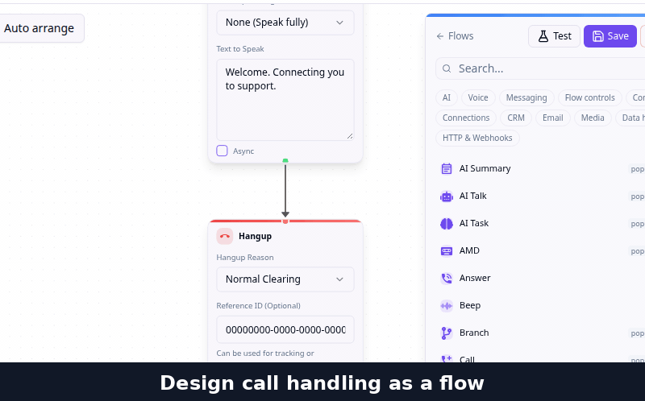
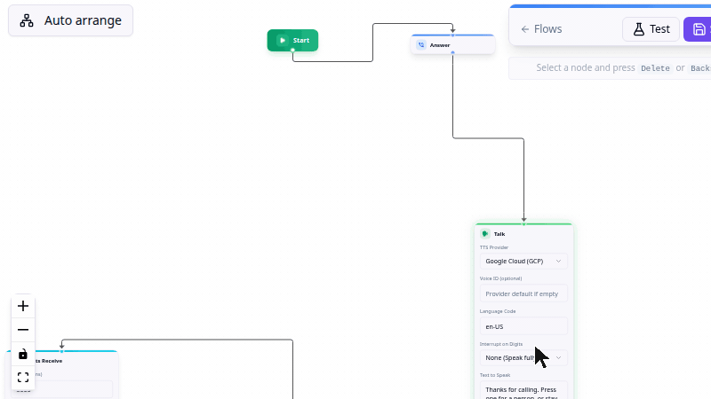
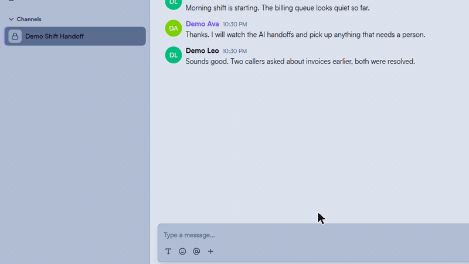
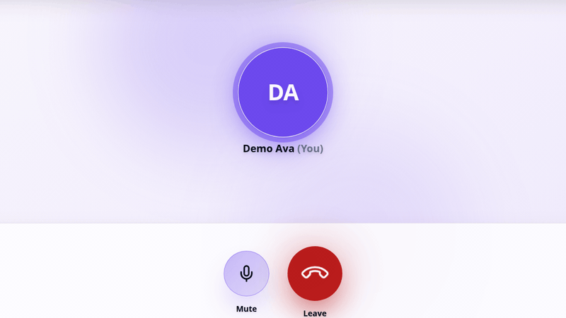

<p align="center">
  <a href="https://voipbin.net">
    <picture>
      <source media="(prefers-color-scheme: dark)" srcset="docs/images/logo-dark.png" />
      
    </picture>
  </a>
</p>

<h1 align="center">VoIPBin</h1>

<p align="center">
  <b>The opensource CPaaS you run on your own server.</b><br />
  Voice, SMS, email, chat, and social messaging, programmable flows, and AI voice agents behind one API.
</p>

<p align="center">
  <a href="https://github.com/voipbin/voipbin/blob/main/LICENSE"></a>
  <a href="https://github.com/voipbin/voipbin/stargazers"></a>
  <a href="https://github.com/voipbin/monorepo/commits/main"></a>
  <a href="https://discord.com/invite/waztvb63Yx"></a>
</p>

<p align="center">
  <a href="#self-host-voipbin">Self-host</a> ·
  <a href="#try-the-hosted-demo">Hosted demo</a> ·
  <a href="#what-you-get">Features</a> ·
  <a href="#your-first-api-calls">API</a> ·
  <a href="#architecture">Architecture</a> ·
  <a href="https://api.voipbin.net/docs/">API docs</a> ·
  <a href="https://discord.com/invite/waztvb63Yx">Discord</a>
</p>

<p align="center">
  
</p>

## Why VoIPBin

Building communications into a product usually means stitching together a SIP stack, a media server, a messaging gateway, a workflow engine, and an AI pipeline, then keeping all of them in sync. VoIPBin ships those pieces as one platform with one REST API, one event stream, and one admin console, and you can run the whole stack on a server you control.

- **Own your stack.** The backend services and the installer are MIT licensed. The API, backend services, web apps, and telephony layer install together on your own host with Docker Compose.
- **One API for every channel.** Calls, conferences, SMS, email, web chat, and social messaging share one REST API, one webhook model, and one event stream. Calls, SMS, web chat, and social messaging run on the same flows.
- **Flows as the control plane.** Describe call and message handling as a sequence of actions, then reuse the same flow across channels and campaigns.
- **AI where the conversation happens.** Attach an AI assistant to a live call, ground it in your own documents, and let it act through tools.
- **Built for multiple tenants.** Customer resources belong to a customer account, with per-account billing, plan-based resource limits, and admin, manager, and agent roles.

## Self-host VoIPBin

The installer in [`install/`](install/) brings up the full stack (API, backend services, SIP and media servers, databases, and the three web apps) on a single Linux or macOS host with Docker Compose.

```bash
git clone https://github.com/voipbin/voipbin.git
cd voipbin/install

./scripts/init.sh --yes          # generate .env, certificates, docker-compose.yml
sudo ./scripts/setup-host.sh     # the only step that needs root
./scripts/start.sh               # start all services
./scripts/check-install.sh       # verify the install
```

What you get after install:

- **Two modes.** An internal mode with a local test domain for development, and an external mode for a real domain with your own TLS certificate.
- **Day-2 operations.** Backup and restore, version pinning and rollback, scheduled jobs, and a `voipbin` CLI for everyday tasks.
- **Your keys, your providers.** Bring your own carrier trunks and your own AI and speech provider keys through `.env`.

After `start.sh`:

- **Open the apps.** Internal mode serves the Admin Console at `http://admin.voipbin.test:3003`, Talk at `http://talk.voipbin.test:3005`, Meet at `http://meet.voipbin.test:3004`, and the API at `https://api.voipbin.test:8443`.
- **Browsing from another machine.** Map the `*.voipbin.test` names to the server first (see [Networking & DNS](install/README.md#networking--dns)), and accept the API certificate at `https://api.voipbin.test:8443` once, because the local certificate authority is trusted only on the server.
- **First account.** `sudo ./voipbin install` (the [guided install](install/README.md#guided-install-sudo-voipbin-install)) creates the first admin account and prints its random password once. The script flow above creates no user account. For a local evaluation install, add `VOIPBIN_SANDBOX_DEV_SEED=true` to `.env` before running `start.sh` to create a test account and an API access key (see [What Gets Created](install/README.md#what-gets-created)). Never enable it on a host reachable from the internet.

Requirements:

- Docker Engine with Docker Compose v2, a multi-core machine with a few GB of free memory, and 15 GiB or more of free disk (3 GiB is the hard minimum).
- Internal mode uses mkcert certificates; `setup-host.sh` installs mkcert if it is missing.
- External mode needs a directly routable host (on-prem server, corporate LAN, or a cloud environment with multiple routable IPs) with separate IP addresses for the host, Kamailio, and RTPEngine. A single-public-IP cloud VM behind NAT is not supported yet.
- File storage (including call recordings) and knowledge bases need a Google Cloud project and service-account key. Text-to-speech playback and real-time transcription need Google Cloud or AWS credentials.

See [`install/README.md`](install/README.md) for the full guide, including DNS, certificates, upgrades, and troubleshooting.

Migrating an existing `voipbin/sandbox` checkout? Follow [Migrating from voipbin/sandbox](install/README.md#migrating-from-voipbinsandbox) before running `init.sh`, to keep your existing data.

## Try the hosted demo

To look around before installing, use the hosted instance. It is meant for evaluation and development, not for production traffic.

| App | What it is | Link |
|---|---|---|
| Admin Console | Build flows, manage numbers, agents, AI assistants, and watch dashboards | [admin.voipbin.net](https://admin.voipbin.net) |
| Talk | Workspace for agents: channels and threads, calls, cases, and contacts | [talk.voipbin.net](https://talk.voipbin.net) |
| Meet | Browser-based audio conferencing | [meet.voipbin.net](https://meet.voipbin.net) |

A guest account is available on the Admin Console login page. Outbound PSTN calls and phone number purchases require an identity-verified customer account. On a self-hosted install you are the operator: you manage account verification and connect your own carriers.

<p align="center">
  
  <br />
  <b>Admin Console</b>
  <br />
  <sub>Build flows, manage numbers, agents, AI assistants, and watch dashboards.</sub>
</p>

<p align="center">
  
  <br />
  <b>Talk</b>
  <br />
  <sub>Workspace for agents: channels and threads, calls, cases, and contacts.</sub>
</p>

<p align="center">
  
  <br />
  <b>Meet</b>
  <br />
  <sub>Browser-based audio conferencing.</sub>
</p>

## What you get

### Voice

- Inbound and outbound calls over PSTN, SIP, and WebRTC, with SIP extensions and trunks
- Call transfer, group calls, recording, and real-time transcription
- Audio conferences with recording and transcription, and participant removal from the API or Admin Console
- Text-to-speech playback in calls, plus streaming speech for live audio
- Outbound routing, provider selection, and outbound controls per account
- QR-code provisioning of SIP softphones for extensions

### Messaging and channels

- SMS
- Email
- Embeddable web chat widget
- Social messaging through LINE and WhatsApp accounts
- Conversations that group messages per contact and channel

### Flows

- Programmable call and message handling built from actions such as `answer`, `talk`, `digits_receive`, `branch`, `queue_join`, `recording_start`, `ai_talk`, `message_send`, `webhook_send`, and `hangup`
- Visual flow editor and flow templates in the Admin Console
- Flow builder chat that drafts a flow from a plain-language description
- Real-time events over WebSocket and webhooks

### AI

- AI voice assistants that join live calls, with your choice of LLM, speech-to-text, and text-to-speech provider
- Your own OpenAI-compatible LLM endpoint, alongside the models listed in `GET /ai_models`
- Knowledge bases (RAG) that ground answers in your documents
- Tool calling, including tools from your own MCP servers
- Call summaries, AI call audits, and prompt improvement proposals
- Insight assistants that analyze existing contacts, cases, and conversations
- AI teams that connect multiple assistants in one conversation graph and hand the conversation between them
- An MCP server ([voipbin/mcp](https://github.com/voipbin/mcp)) so external AI agents can operate VoIPBin

### Contact center

- Agents and queues with routing to available agents
- Outbound campaigns that run calls or flows against dial lists (outdials)
- Contacts with addresses, interaction history, and cases
- Talk, an agent workspace for channels, calls, cases, and contacts
- Tags for organizing resources

### Platform

- Multi-tenant customer accounts with admin, manager, and agent roles
- Access keys for API authentication
- Billing accounts, usage records, and plan-based resource limits
- File storage for recordings and media
- Event timelines for calls, conferences, and flow runs, with SIP analysis and AI analysis
- Prometheus metrics from the backend services

## Your first API calls

The REST API is documented at [api.voipbin.net/docs](https://api.voipbin.net/docs/). The examples below authenticate with an access key (create one in the Admin Console or with `POST /accesskeys`; a dev-seeded local install prints one at the end of its first `start.sh` run) passed as the `accesskey` query parameter. Keys in URLs can end up in proxy logs, so keep them out of shared logs. They work against a self-hosted install as well; replace the host with your own API domain, for example `https://api.voipbin.test:8443/v1.0` in internal mode.

```bash
export VOIPBIN_API="https://api.voipbin.net/v1.0"
export VOIPBIN_ACCESSKEY="<your access key>"
```

List your numbers:

```bash
curl "$VOIPBIN_API/numbers?accesskey=$VOIPBIN_ACCESSKEY"
```

Create an AI voice assistant. `engine_model` takes a model ID from `GET /ai_models`; for direct-provider models such as this one, `engine_key` is your key for that model's provider. On a self-hosted install, the speech providers used here also need their keys in `.env`.

```bash
curl -X POST "$VOIPBIN_API/ais?accesskey=$VOIPBIN_ACCESSKEY" \
  -H "Content-Type: application/json" \
  -d '{
    "name": "Support assistant",
    "detail": "Answers first-line support calls",
    "engine_model": "gemini.gemini-2.5-flash",
    "engine_key": "<your provider API key>",
    "parameter": {},
    "init_prompt": "You are a friendly support agent for Acme Inc. Keep replies under two sentences.",
    "tts_type": "elevenlabs",
    "tts_voice_id": "<voice ID>",
    "stt_type": "deepgram"
  }'
```

Create a flow that answers a call, greets the caller, and hands the call to that assistant. On a self-hosted install, the `talk` action needs Google Cloud or AWS credentials in `.env`.

```bash
curl -X POST "$VOIPBIN_API/flows?accesskey=$VOIPBIN_ACCESSKEY" \
  -H "Content-Type: application/json" \
  -d '{
    "name": "AI front desk",
    "detail": "Greets callers and connects them to the support assistant",
    "actions": [
      {"type": "answer"},
      {"type": "talk", "option": {"text": "Thanks for calling Acme.", "language": "en-US"}},
      {"type": "ai_talk", "option": {"assistance_type": "ai", "assistance_id": "<id from the previous response>"}},
      {"type": "hangup"}
    ]
  }'
```

Set the flow as a number's `call_flow_id` (or `message_flow_id` for SMS), and incoming traffic to that number runs it. A Go SDK is available at [voipbin/voipbin-go](https://github.com/voipbin/voipbin-go) and a command-line client at [voipbin/vn](https://github.com/voipbin/vn).

## Architecture

```
            Admin Console · Talk · Meet · REST API · WebSocket
                                   │
                       ┌───────────▼───────────┐
                       │      API gateway      │
                       │    (bin-api-manager)  │
                       └───────────┬───────────┘
                                   │  RabbitMQ
   ┌───────────────────────────────▼────────────────────────────────┐
   │  Go services: calls, flows, AI, conversations, messages,       │
   │  email, web chat, queues, campaigns, agents, contacts,         │
   │  conferences, numbers, billing, storage, webhooks, timelines   │
   └───────────────────────────────┬────────────────────────────────┘
                                   │
   ┌───────────────────────────────▼────────────────────────────────┐
   │  SIP and media: Kamailio · Asterisk · RTPEngine                │
   │  Data: MySQL · Redis · PostgreSQL · ClickHouse                 │
   └────────────────────────────────────────────────────────────────┘
```

- The API gateway is the single entry point for the REST API and the event WebSocket. Backend services talk to each other over RabbitMQ.
- Kamailio handles SIP signaling, Asterisk handles call and conference media under control of the Go services, and RTPEngine relays media, including WebRTC.
- SIP phones, carrier trunks, and the WebRTC audio of Talk and Meet connect directly to Kamailio and RTPEngine, not through the API gateway.
- AI voice sessions run in a dedicated pipeline service that connects the call audio to the configured speech and LLM providers.

The backend source lives in [voipbin/monorepo](https://github.com/voipbin/monorepo).

## Data and security

- **Runs where you put it.** On a self-hosted install, the databases run on your own host, and call recordings and other files are stored in a bucket in your own Google Cloud project.
- **External services are your choice.** Carriers, LLM, speech, and email providers, and the Google Cloud project used for file storage, knowledge bases, and speech, are services you pick and connect with your own credentials.
- **Encrypted transport.** TLS for the API, TLS and WebSocket Secure for SIP signaling, and SRTP support for media. The web apps are plain HTTP by default; put them behind TLS with `--web-reverse-proxy` in external mode or your own reverse proxy.
- **Per-customer isolation.** Customer resources are scoped to their customer account, API access is checked against the caller's account and role, and platform-wide settings such as carrier providers are limited to the operator.
- **Auditable.** The backend services, API definition, and installer are MIT licensed and public.

## Repositories

| Repository | What it contains |
|---|---|
| [voipbin/voipbin](https://github.com/voipbin/voipbin) | This overview and the Docker Compose installer ([`install/`](install/)) |
| [voipbin/monorepo](https://github.com/voipbin/monorepo) | Backend services, API definition, and API documentation |
| [voipbin/voipbin-go](https://github.com/voipbin/voipbin-go) | Go SDK |
| [voipbin/vn](https://github.com/voipbin/vn) | Command-line client |
| [voipbin/mcp](https://github.com/voipbin/mcp) | MCP server for AI agents |

The former `voipbin/install` and `voipbin/sandbox` repositories are archived; the installer now lives in [`install/`](install/).

## Contributing

Bug reports, documentation fixes, and pull requests are welcome.

- Installer and this README: open an issue or PR in this repository.
- Backend services and API: [voipbin/monorepo](https://github.com/voipbin/monorepo).
- SDK, CLI, and MCP server: their own repositories listed above.

Questions are welcome on [Discord](https://discord.com/invite/waztvb63Yx).

## Contact

- Website: [voipbin.net](https://voipbin.net)
- Email: [support@voipbin.net](mailto:support@voipbin.net)
- Discord: [discord.com/invite/waztvb63Yx](https://discord.com/invite/waztvb63Yx)

## License

VoIPBin is opensource software released under the [MIT License](LICENSE).
